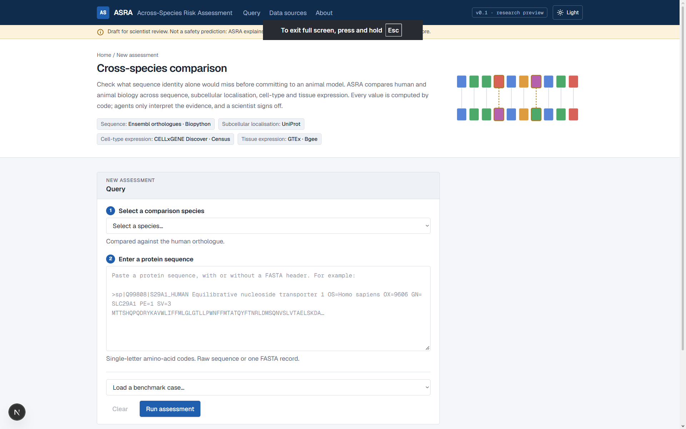
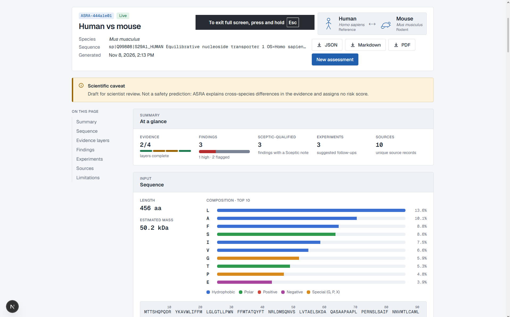
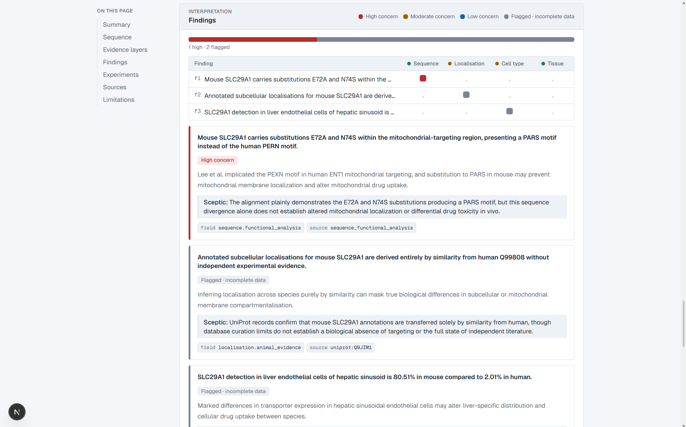

# ASRA — Across-Species Risk Assessment

### When animal biology does not cleanly translate to humans.

*UCL Agentverse 2026 — Biotech Track*

<mark>*WARNING: BE AWARE THE ENSEMBL DATABASE IS CURRENTLY DOWN, SO ALL LAYERS COULD GIVE INCOMPLETE STATUS'S (AS OF 8/11/2026)*<mark>

**ASRA is an evidence-grounded AI investigator for preclinical translation.** It helps
researchers examine where animal evidence may not reliably transfer to humans, by combining
four biological evidence layers, structured tool outputs and a multi-agent review process.

**ASRA does not predict drug safety.** It identifies translational risk signals, evidence
gaps and uncertainty. You give it a human protein and an animal model; it compares the two
species across four independent layers, has three agents argue about what the differences
mean, and returns a report in which **every claim carries a source record and no number is
invented by a language model.**

It is built to surface a documented interspecies difference that sequence identity alone
would miss. It does not claim it "would have caught" any historical clinical failure — in
the known cases the mechanistic explanation was published years after the trial. That
wording is deliberate and consistent across the report, the UI and this file.

---

## The website

**1 · Ask the question.** Pick a comparison species and paste a protein sequence, raw or as a
FASTA record. The four evidence layers and their sources are named up front, and a benchmark
case can be loaded instead of pasting.



**2 · Read the evidence.** The report opens on *At a glance* — how many layers returned
complete data, how many findings there are and how many the Sceptic qualified, plus the
source-record count. The badge beside the entry ID states the data origin, so a demo fixture
can never be mistaken for a live retrieval. JSON, Markdown and PDF export from here.



**3 · See what was claimed, and what was pushed back on.** Each finding shows its concern
level, the mechanism, the Sceptic's note, and the exact `field` and `source` it rests on. The
matrix on the right maps every finding to the layer that supports it.



---

## Demo

https://github.com/user-attachments/assets/51f0b54e-d7d4-4606-847a-a11d294f5edf

---

## Problem and who it helps

**The problem.** Traditional animal-to-human extrapolation can miss differences in protein
conservation, cellular localisation and gene expression. These differences can weaken the
biological assumptions behind preclinical decisions.

Two orthologous proteins can be 90% identical in sequence and still behave differently in a
way that kills a trial. Sequence identity cannot distinguish them on the axes that matter:
*where in the cell* the protein sits, *which cell types* express it, *which tissues* carry it.
ASRA checks those axes separately and reports the differences it can actually evidence.

**Who it helps.** Preclinical researchers, pharmacologists and drug-development teams who
need an evidence-backed view of whether a target behaves similarly across species.

The hard problem is not finding differences — it is not inventing them. Hence the rules below.

## The four rules everything obeys

| Rule | Where it's enforced |
|---|---|
| **Agents never produce a number.** Python computes every value; agents only add `Finding`s. | `pipeline/runner.py`, `report/builder.py` |
| **No claim without a source.** Every `Finding.sourceRecordId` must match a `SourceRecord` from a layer that ran. | `agents/sceptic.py` deterministic pass |
| **Never invent data.** A layer that can't run returns `status: "unavailable"` with a reason — never empty-but-"ok". | `tools/base.py`, every layer |
| **No numeric risk score.** Concern is qualitative: `high · moderate · low · flagged`. Anything resting on incomplete data becomes `flagged`. | `contract/models.py`, Sceptic |

Layers fail independently: one layer erroring becomes `unavailable` while the other three
still run.

---

## Quickstart

**Backend** (Python 3.11+):

```sh
cd Backend
pip install -r requirements.txt
cp .env.example .env          # then add your GEMINI_API_KEY
uvicorn main:app --reload --port 8000
```

API docs land at http://localhost:8000/docs · liveness at `GET /health`.

**Frontend** (Node 20+):

```sh
cd Frontend
npm install
cp .env.example .env.local    # NEXT_PUBLIC_USE_MOCK=false, API_URL=http://localhost:8000
npm run dev
```

Open http://localhost:3000.

Without a `GEMINI_API_KEY` the pipeline still runs end to end — the layers all work and the
agents simply produce no findings rather than inventing any. Set `NEXT_PUBLIC_USE_MOCK=true`
to do UI work with no Python running at all.

**One request, no frontend:**

```sh
curl -X POST localhost:8000/assess -H "Content-Type: application/json" -d '{
  "species": "mus_musculus",
  "sequence": "MKTAYIAKQRQISFVKSHFSRQLEERLGLIEVQAPILSRVGDGTQDNLSGAEKAVQVKVKALPDAQ",
  "sequenceLabel": "SLC29A1"
}'
```

A full live run takes ~90s: four layers hit five external APIs in parallel, then two Gemini
calls run in sequence.

---

## How a request flows

```
AssessmentRequest
      │
      ▼
tools/resolver.py ──────────────► ResolvedQuery (species, sequence, label, gene|None)
      │                           gene comes ONLY from a human UniProt GN= header or a
      │                           bare uppercase symbol — never a first-token guess
      ▼
┌─────────────────────────────────────────────────────────────┐
│  4 layers, parallel threads, isolated (run_isolated)        │
│                                                             │
│  sequence          Ensembl orthologue + Biopython alignment │
│  localisation      UniProt subcellular compartments         │
│  cell_expression   CELLxGENE Discover / Census              │
│  tissue_expression GTEx medians beside Bgee calls           │
└─────────────────────────────────────────────────────────────┘
      │  4 × LayerResult (order preserved)
      ▼
┌─────────────────────────────────────────────────────────────┐
│  Investigator  →  Interpreter  ⇄  Sceptic   (one revision)  │
└─────────────────────────────────────────────────────────────┘
      │  findings + experiments + gaps
      ▼
report/builder.py ──────────────► Report  ──►  runs.jsonl
```

### The four layers

| Layer | Asks | Sources | Note |
|---|---|---|---|
| **1. Protein conservation** (`sequence`) | How do the orthologous proteins differ residue by residue, and do differences fall in annotated functional sites? | Ensembl + Biopython for orthologues, identity and alignment coverage; UniProt features | With no resolved gene, falls back to submitted-length-only `incomplete` |
| **2. Subcellular localisation** (`localisation`) | Where is the protein reported to be located within the cell, in each species? | UniProt | Compares exact location IDs; no ontology ancestor expansion |
| **3. Cell-type expression** (`cell_expression`) | Which cell populations express the gene? | CZ CELLxGENE | Always `incomplete` via the Discover API — aggregates lack per-dataset provenance |
| **4. Tissue expression** (`tissue_expression`) | What is the tissue-level expression context, and what cross-species evidence exists? | GTEx + Bgee, matched on UBERON | Nothing is ever divided across GTEx and Bgee — incompatible scales |

### The three agents

| Investigator | Interpreter | Sceptic |
|---|---|---|
| Collects evidence | Synthesises findings | Challenges unsupported claims |

Python computes the biological measurements; Gemini agents coordinate evidence gathering,
explanation and critique. Structured JSON keeps tool outputs auditable, and a revision loop
lets the Sceptic challenge unsupported conclusions.

**Investigator** — deterministic, no model call. Splits layers into citable evidence and
excluded ones. With four fixed layers there is no tool choice left for a model to make. Its
`gaps` become report limitations and "obtain this data" experiments.

**Interpreter** — Gemini, drafting findings against a restricted schema. It cannot choose
finding IDs (Python assigns them) and it cannot write its own sceptic note. Each finding
carries a suggested experiment. A failed call returns nothing rather than something.

**Sceptic** — gets the **raw** layer results, not just the Interpreter's output, so it checks
claims against evidence instead of reinforcing the same error. Two passes:

1. *Deterministic* — rejects a finding whose cited field isn't backed by its source record;
   rejects clinical-safety language; rejects treating a missing annotation as proven
   biological absence; rejects RNA expression used as protein abundance; rejects GTEx÷Bgee
   ratios; forces anything resting on `incomplete` data to `flagged`.
2. *Gemini* — per-finding verdicts that can only ever **weaken**: `accept`, `downgrade`,
   `reject`. Never promote. A crash here leaves findings exactly as the deterministic pass
   left them.

Then exactly **one** revision cycle, so a demo can never hang in open-ended debate. An
experiment survives only as long as its finding does.

Every prompt and every response is appended to `Backend/data/logs/runs.jsonl`, so you can
show precisely what went into the model and what came back.

---

## The contract

One JSON format is shared by every part of the system, defined in two places that must stay
in sync — `Backend/contract/models.py` (Pydantic) and `Frontend/lib/types.ts` (TypeScript).
`LayerResult` uses snake_case; everything else is camelCase on the wire.

```jsonc
{
  "id": "uuid",
  "origin": "live",                  // live | fixture | mock
  "sequenceStats": { "length": 66, "estimatedMassKDa": 7.27, "composition": [] },
  "layers": [ /* four LayerResults, in LayerName order */ ],
  "findings": [{
    "claim": "One-sentence statement of the cross-species difference.",
    "mechanism": "Why it might matter.",
    "concern": "flagged",
    "citedField": "localisation.shared_compartments",
    "sourceRecordId": "uniprot:Q99808",
    "scepticNote": "Rests on incomplete data; downgraded."
  }],
  "recommendedExperiments": [],
  "limitations": []
}
```

Nine supported species: mouse, rat, rhesus and cynomolgus macaque, dog, pig, rabbit, guinea
pig, zebrafish.

**Endpoints**

| Method | Path | Purpose |
|---|---|---|
| `GET` | `/health` | Liveness |
| `POST` | `/assess` | Full pipeline — the one the frontend uses |
| `POST` | `/assess/agent-pipeline` | Runs the agent stages directly against supplied evidence, returning every intermediate stage |

---

## Evaluation

`tests/test_cases.md` holds four hand-written cases, **committed before any results were
generated**, each with pass / partial / fail criteria and a full citation table:

1. **Fialuridine** (SLC29A1 / mouse) — tests the localisation axis. Human ENT1 is reported in
   the mitochondrial membrane; the mouse transporter is not. The Sceptic must flag that a
   missing mouse annotation is not evidence of absence.
2. **TGN1412** (CD28 / macaque) — tests the cell-type axis. The protein is present in both
   species, so neither sequence identity nor bulk tissue expression resolves it: human CD4+
   effector-memory T-cells express CD28, the corresponding macaque population is CD28−.
3. **GAPDH conserved control** (mouse) — proves the system raises no alarm on a conserved
   housekeeping gene.
4. **CYP3A4 / mouse** — tests honesty under absence. There is no one-to-one mouse orthologue
   (the mouse Cyp3a locus holds at least six genes), so the sequence layer must refuse to
   return an identity figure rather than arbitrarily pick a paralogue.

### Results

All four cases were run live against `/assess` on 2026-11-08 and scored against those
pre-committed criteria. Full write-up in [`evaluation_results.md`](evaluation_results.md);
raw responses frozen in [`tests/frozen/`](tests/frozen).

| Case | Sequence alone caught it? | Extra layers added evidence? | Sceptic caught the unsupported claim? | Verdict |
|---|---|---|---|---|
| SLC29A1 / mouse | No | Yes — UniProt Q99808 (entry v215) with experimental human compartments | Yes — downgraded 2 of 3 findings | **Pass** |
| CYP3A4 / mouse | No — refused, correctly | Yes — named the one-to-many orthology and propagated it to all three other layers | Yes — downgraded the single finding | **Pass** |
| GAPDH / mouse | No (layer failed) | Yes | Yes — flagged that a missing mouse annotation isn't biological absence | Partial |
| CD28 / macaque | No | Yes — 15 observations, 7 source records, but from a **recorded** Census run, not live | Yes — noted the finding rests on curated literature | Partial |

**In 4 of 4 cases the additional layers surfaced evidence that sequence identity alone did
not capture.** In three of those four the sequence layer failed outright and the others still
produced citable evidence — the layered design degraded gracefully rather than collapsing.

Biological checks: **79.39% identity** for SLC29A1 human/mouse (366/461 columns),
**98.18% identity** for CD28 human/rhesus, and **CYP3A4/mouse ambiguity preserved** —
Ensembl lists nine `ortholog_many2many` mouse *Cyp3a* genes, and the layer returned
`unavailable` rather than forcing an unsupported match.

Code tests live separately in `Backend/tests/` (16 files). Run them from `Backend/`:

```sh
pytest
```

On the combined validation branch the backend suite reported **336 passed, 21 skipped, zero
failures**. See [Known issues](#known-issues) for what a plain `master` checkout gives today.

---

## Safeguards and limitations

**Safeguards.** Source identifiers and citations on every claim, explicit marking of missing
or ambiguous evidence, and Sceptic review of each finding. The system is designed to **show
uncertainty rather than hide it**.

**Limitations.** ASRA does not establish clinical safety or efficacy. Sequence similarity
does not prove functional equivalence. A missing annotation is never evidence of biological
absence. All findings require expert interpretation and experimental validation.

---

## Project layout

```
Backend/
  main.py              FastAPI app + CORS wiring only
  api/routes.py        every HTTP route
  contract/models.py   the universal JSON format (source of truth)
  tools/               resolver + the four layers + literature, fixtures, stats
  agents/              investigator, interpreter, sceptic, orchestrator, llm, prompts/
  pipeline/runner.py   request → layers → agents → report
  report/builder.py    assembles the Report, writes report-wide limitations
  data/                caches, benchmarks, logs/runs.jsonl
  tests/               pytest suite
Frontend/
  app/                 Next.js App Router
  components/          assessment form, report views, layout, ui
  lib/                 types.ts, sequence.ts, api/, export.ts, caseStudies.ts
tests/                 scientific acceptance criteria, frozen case outputs, precache list
evaluation_results.md  the four cases, run live and scored
docs/                  the screenshots and demo video used above
```

## Data sources

| Source | Used for | Version observed in a live run | Licence |
|---|---|---|---|
| [Ensembl](https://www.ensembl.org) | Orthologues, gene models, sequence layer | not yet recorded by the layer | Data: EMBL-EBI Terms, CC BY 4.0 · API: Apache 2.0 |
| [UniProt](https://www.uniprot.org/help/license) | Subcellular localisation and evidence codes | `UniProt 2026_04` | CC BY 4.0 |
| [CZ CELLxGENE Discover](https://chanzuckerberg.github.io/cellxgene-census/) | Cell-type expression | `Discover WMG snapshot 1762972271` | Data: CC BY 4.0 · package: MIT |
| [GTEx](https://gtexportal.org) | Human tissue expression | `gtex_v8 (GENCODE v26)` | Open-access summary data only |
| [Bgee](https://bgee.org) | Cross-species tissue expression calls | API, retrieval date recorded | to confirm on bgee.org |
| [Biopython](https://biopython.org) | Pairwise sequence alignment | from `requirements.txt` | Biopython License Agreement (BSD-style) |

No patient-level data is used. GTEx protected (dbGaP-controlled) data is out of scope. Each
layer records the release of the source it queried in its `data_version` field; the sequence
layer does not yet populate it.

## Known issues

- On `master`, `Backend/tests/test_cell_census.py` and `test_cellxgene_discovery.py` each
  carry a duplicated `from __future__ import annotations`, which is a `SyntaxError`. Because
  collection errors interrupt pytest, this blocks the whole suite. Excluding those two files,
  316 tests pass and 14 are deliberately skipped (opt-in live-API checks). The fix is already
  on `audit/role4-biological-validation` (BUG-1 in
  [`Backend/docs/role4_overnight_validation.md`](Backend/docs/role4_overnight_validation.md))
  and lands on `master` when that branch merges.
- `Backend/api/models.py` and `api/sequence.py` are unreferenced duplicates of
  `contract/models.py` and `tools/sequence_stats.py`, and can drift from the contract.
- The localisation and cell-expression layers return `incomplete` on most inputs; for
  localisation this is largely because animal UniProt compartments are frequently annotated
  by similarity from the human entry rather than independently.
- `cellxgene-census` has no Windows wheels, so on Windows the cell layer uses the CELLxGENE
  Discover HTTP API or a recorded Census run.
- There is no CI configuration.

## Collaborators

Built for UCL Agentverse 2026 by **Shiven K · Elijah Onyenjiaka · Akmal Shaik ·
Alvaro Alfaro · Angel Boateng** — backend orchestration and integration, Gemini reasoning
and citation validation, the protein sequence engine, the biological evidence layers, and the
web interface. Repository: [github.com/OrionSilverStorm/asra](https://github.com/OrionSilverStorm/asra).

## Licence

Not yet specified. Each upstream data source keeps its own licence, listed above.
